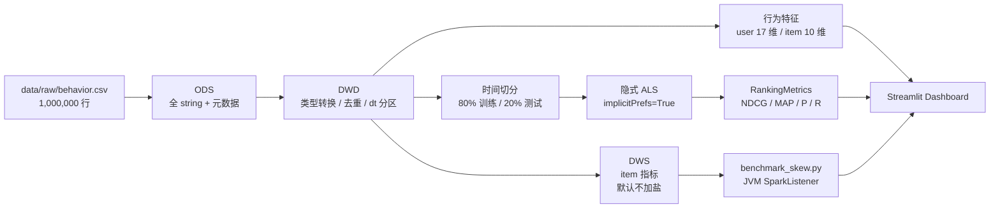

# SparkSkew-Benchmark

**PySpark 电商行为特征工程与隐式推荐 pipeline**：使用 100 万行行为日志，
完成 ODS → DWD → DWS 分层建模，数据质量断言与对账，Shuffle 倾斜 benchmark，
行为序列特征，时间切分隐式 ALS 评估，以及一个基于 Streamlit 搭建的可视化看板。


**GitHub 仓库**：<https://github.com/WhiteEagleNight/SparkSkew-Benchmark>

---

## 项目目标与核心特性

本项目并非单一维度的数据清洗或模型训练 Demo，而是覆盖了从数据接入、质量治理
到模型评估的完整工程链路，主要包含以下四个方面：

1. **规范化数仓分层**：实现原始 CSV 到 ODS、DWD、DWS 的完整流转，并附带严格的
   数据质量断言与跨表对账机制。
2. **Shuffle 倾斜的性能实测**：基于 38.04% 的热 key 场景，完整对比不加盐、
   全量加盐、仅热点键加盐三种两阶段聚合在执行耗时、最长 Task、Shuffle 数据量
   和实际 group 基数上的真实差异，并做 2 / 5 / 20 盐桶敏感性扫描。
3. **完整的隐式 ALS 评估链路**：针对无显式评分的场景，实现严格的时间切分与冷启动
   过滤，并基于 NDCG、MAP 等排序指标进行评估（不计算不适用的 RMSE）。
4. **结构分离的可视化看板**：Dashboard 与计算逻辑完全解耦，仅通过读取离线产出的
   JSON 文件进行展示，避免在页面内进行实时重计算。

> 本项目的 benchmark 是一个**条件性负结果**：在 Windows 11、`local[8]`、
> 16 个 shuffle partition、关闭 AQE、100 万行、38.04% 热 key 的
> `count/sum`（可 map-side combine）负载上，本实现里的加盐方案比不加盐慢。
> 这里保留真实数据和原因分析；这个结果不能外推到生产规模、其他数据分布，
> 也不能外推到开启 AQE 的环境——生产 Spark 3.x 通常默认开启 AQE，净收益可能不同。
> 因此 DWS 默认走**不加盐**路径；加盐路径保留为 `--salted` 的演示/回归入口，
> 不作为本负载的生产默认。两者产出同一张 DWS，并接受相同的对账断言。
>
> 本项目还对比了**仅热点键加盐**：只给 item `9999` 分桶，其余 item 保持
> `_salt=0`。它把 stage-1 实际 group 数从全量加盐的 190,924 压回 20,009，
> 额外 Shuffle 明显变小；但在本实验这份可 Combine 的聚合上仍然没有正收益。

---

## 架构



数据流：

| 层 | 路径 | 内容 |
|---|---|---|
| Raw | `data/raw/behavior.csv` | `user_id,item_id,category_id,behavior_type,event_time` |
| ODS | `data/warehouse/ods/behavior_raw` | 全列 string，附 `_ingest_ts`，`_source_file` |
| DWD | `data/warehouse/dwd/behavior_events` | 强类型，去重，`dt` 分区，4 条质量断言 |
| DWS | `data/warehouse/dws/item_stats` | 每个 item 一行，pv/cart/fav/buy 计数与时间范围 |
| Features | `data/warehouse/features/{user,item}_features` | 17 维用户特征，10 维商品特征 |
| Model | `data/warehouse/models/als_implicit` | 隐式 ALS 模型 |
| Results | `benchmark_results.json`，`evaluation_results.json` | 真实实验产物，Dashboard 只读 |

---

## Benchmark & Findings（性能测试与真实发现）

以下数字全部来自本机实际运行，环境为 **Windows 11 + Spark 3.5.1 +
`local[8]` + 16 shuffle partitions + AQE off**。换机器/换配置可能会有所不同。

### 数据规模

| 指标 | 实际值 |
|---|---:|
| 行为行数 | 1,000,000 |
| 用户数 | 50,000 |
| 商品数 | 20,000 |
| 热门商品 9999 行数 | 380,421 |
| 热门商品占比 | **38.04%** |
| 冷启动（仅测试期出现）用户 | 5,000 / 45,054 = **11.0978%** |

### Shuffle benchmark（1M 行，第二次运行，单样本）

| 方案（10 桶） | Wall clock | 最长 Task | Shuffle read/write | Stage-1 实际 group 数 |
|---|---:|---:|---:|---:|
| 不加盐两阶段 | **2.354s** | **456ms** | 10.630MB | 20,000 |
| 全量加盐两阶段 | **3.408s** | **846ms** | 18.418MB | **190,924** |
| 仅热点键加盐两阶段 | **2.806s** | **552ms** | 11.522MB | **20,009** |
| 全量加盐 vs 不加盐 | **+44.77%** | **+85.53%** | +73.27% | — |
| 仅热点键加盐 vs 不加盐 | **+19.20%** | **+21.05%** | +8.39% | — |

> 上表是 2026-11-08 的 `benchmark_results.json`（每种方案第 2 次运行）。
> 单机短任务方差较大，绝对值会随机器负载变化；**单次运行、无重复采样，百分比
> 仅方向性参考**，统计口径见下。
>
> **统计口径**：每种方案只有 **1 个进入统计的 measured sample**（第 2 次运行；
> 第 1 次只用于预热）。表中的百分比是这一次运行相对同批次不加盐的差异，
> **没有重复采样、没有置信区间、也没有做显著性检验**。Shuffle records、
> group 基数、Task 数是确定性结构指标，方向更稳；wall clock 和最长 Task
> 的百分比应理解为该次运行的方向性证据，不是精确效应量。

真实原因：

- 不加盐时 stage-1 shuffle write 只有 **440,303** 条记录（输入 1,000,000 行），
  Spark 的 map-side partial aggregation 已经把热门 key 合并；
- 全量加盐后 stage-1 的 group 数理论上限是 `20,000 × 10 = 200,000`，实测
  distinct `(item_id, _salt)` 是 **190,924**，在本写法下多一次 shuffle，
  stage-1 shuffle write 变成 **598,054** 条；
- 仅热点键加盐只拆 item 9999，stage-1 实际 group 数是 **20,009**，
  stage-1 shuffle write 是 **440,708** 条，接近不加盐；但两阶段仍需
  额外一次 shuffle，所以 wall clock 和最长 Task 仍高于不加盐；
- 因此在这个**可合并聚合**上，两种加盐方式的净开销都为正，全量加盐更重。
- 这里的 group 基数膨胀不是独立根因，而是“加盐改变聚合 Key”后的**机制表现**：
  stage-1 的 key 从 `item_id` 变成 `(item_id, _salt)`，原本可被 Catalyst 合并的
  同 Key 两阶段聚合被阻断，因此在本写法下多出一次 shuffle；group 数变大是
  这条链路上的中间结果，不是另一个可以被单独消除的根因。

> **结论（仅限本实验条件）**：在上述 `local[8]`、16 分区、AQE off、100 万行、
> 38.04% 热 key 的 `count/sum` 负载上，Spark 的 Map 端预聚合（Combine）已经把
> 热 key 压小；本实现里的加盐方案额外改写了 stage-1 的聚合 Key，阻断了原本可被
> Catalyst 合并的同 Key 两阶段聚合，因此在本写法下多出一次 shuffle，净开销为正。
> 这不等于“加盐天然更差”，也不能外推到生产规模或开启 AQE 的环境。加盐值得优先
> 验证的场景是复杂 Join 或 groupByKey 长尾倾斜，但**即便在这些场景，也要实测
> 净收益**，不能默认加盐一定有效。如果聚合本身可以在 map 端合并，应先让 Spark
> 做 combine。
>
> 三种方案的对比本身是真实的；但归因边界只到“本实现”：不加盐可能享受 Catalyst
> 对同 Key 两阶段聚合的合并，加盐方案则不能，两者并不是只差一个布尔位。这个公平性
> 差异是加盐成本的一部分，不是被隐藏的变量。
>
> **边界**：这只证明本项目这份 1M 行、38.04% 热 key、`count/sum`、`local[8]`、
> 16 分区、AQE off 负载上的结果，不能外推为“加盐对所有可 Combine 负载都是
> 负优化”，也不能外推到生产规模或开启 AQE 的环境。本实验最长 Task 只有
> 456ms，长尾并不严重；“仅热点键加盐仍然为负”只适用于这份实现和负载；如果是
> Join 倾斜或 groupByKey 长尾、单 Task 达到数千万行，加盐仍可能有效，但必须
> 实测净收益。反过来，不可 Combine 也只是加盐可能有效的**必要条件，不是充分
> 条件**；额外 Shuffle、group 膨胀、第二阶段是否仍倾斜，都要用同一套指标验证。

**对比口径**：三种方案都写成同样的逻辑两阶段聚合（先部分聚合，再恢复
`item_id`）。被控制的 treatment 是 **salt scope**，不是“整个物理计划只差一个
布尔位”：不加盐的两次 `groupBy("item_id")` 可能被 Catalyst 合并成一次 shuffle；
而加盐方案在本写法下会多一次 shuffle，因为 stage-1 的 key 是
`(item_id, _salt)`，stage-2 才恢复 `item_id`，通常无法享受同 Key 两阶段聚合的
合并。这次额外 shuffle 属于加盐的真实成本，benchmark 不会把它藏起来，而是把
stage 数和 shuffle 字节一并报告。

固定 16 个 shuffle partitions，关闭 AQE；用 `collect()` 强制物化，不让
Catalyst 的 Count 优化跳过阶段；三种方案交错运行两次，取第二次的数据，避免
预热误差。最长 Task 时间由 JVM 的 `SparkListener` 采集，采不到就标记降级。
实际 group 基数用 `distinct(item_id, _salt)` 现场测量，不拿理论上限冒充实测值。

### 盐桶敏感性（2 / 5 / 20 桶）

`pipelines/benchmark_salt_sweep.py` 复用同一份缓存 DWD 和同一套测量代码，
只改变 `salt_buckets`。每个桶数下三种方案各跑 2 次，取第 2 次：

| 盐桶数 | 不加盐（桶内独立重跑） | 全量加盐 | 仅热点键加盐 | 全量加盐变化 | 仅热点键加盐变化 |
|---:|---:|---:|---:|---:|---:|
| 2 | 2.211s | 2.526s | 2.460s | +14.25% | +11.26% |
| 5 | 2.033s | 2.788s | 2.348s | +37.14% | +15.49% |
| 20 | 2.156s | 2.906s | 2.346s | +34.79% | +8.81% |

对应实际 group 基数：2 桶时全量加盐 40,000、热点键加盐 20,001；5 桶时
99,799 / 20,004；20 桶时 315,405 / 20,019。全量加盐的 group 数随桶数增长，
但 5 桶和 10 桶已经出现 Hash 碰撞（理论上限 100,000 / 200,000），这正说明
“理论上限”不能当成实测值。10 桶基准点由 `benchmark_skew.py` 单独产出，
sweep 默认不重复测量 10 桶，避免两个文件争同一个“10 桶结果”。

> **sweep 口径**：每个桶数都独立重跑了三种方案（包括不加盐 baseline），
> 所以每一行是桶内配对比较；但 baseline 自身在 2.033s–2.211s 之间漂移，
> 跨桶比较百分比时，差异里混有 baseline 漂移和单次运行噪声。不能把
> 20 桶的 +8.81% 与 2 桶的 +11.26% 的差全部归因于桶数本身。sweep 同样只有
> 每个桶 1 个 measured sample，没有做显著性检验。

---

## Model Evaluation（模型评估）

### 隐式 ALS 评估（时间切分 80%）

| 指标 | @10 | @20 |
|---|---:|---:|
| NDCG | **0.000963** | 0.001115 |
| MAP | 0.000716 | 0.000749 |
| Precision | 0.000209 | 0.000154 |
| Recall | 0.001180 | 0.001702 |

**NDCG@10 = 0.000963**（详见 `evaluation_results.json`）。

评估协议：

- 按 `event_time` 的 80% 分位切分，训练用 `<=` 切分点，测试用 `>`；
  训练 799,907 行（79.9907%），测试 200,093 行（20.0093%）；
- 测试期出现，训练期未出现的用户无法被 ALS 打分，从主评估中过滤，但单独
  报告比例：5,000 / 45,054 = **11.0978%**；
- 训练期已见商品对 `seen` 做 left anti join，避免把“记住训练集”算成推荐；
- 指标用 `RankingMetrics` 的 NDCG@K，MAP@K，Precision@K，另算 Recall@K。

其他真实数字：

- 训练 users 45,000，测试 users 45,054；
- 训练交互 540,426，密度 0.00060047，ALS 拟合 **37.263s**；
- 参与评估 33,528 人，平均测试新商品 1.8469 个；
- 冷启动 popularity fallback：NDCG@10 **0.225296**，MAP@10 **0.080858**，
  Precision@10 **0.100300**。

**为什么 ALS 指标接近随机**：合成数据中非热门商品基本均匀随机，用户之间没有
可学习的协同偏好；热门商品 9999 几乎被每个训练用户见过，按协议从候选剔除。
剔除后是在 20,000 个近乎随机商品上排序，指标偏低源于数据性质，并非评估代码
计算错误。冷启动 fallback 可以把热门商品推荐给没有历史的新用户，因此指标更高，
但它与 ALS 是不同 cohort，不能直接横向比较。

> **结论**：由于使用了 Mock 随机数据（缺乏真实的协同信号），指标接近随机。
> 但 Pipeline 已完整实现了 RankingMetrics 评估与冷启动过滤，替换真实数据
> 即可直接用于生产；当前 0.000963 只证明评估链路正确，不能当作线上效果。

**隐式反馈不适用 RMSE**。行为日志没有显式评分，未点击也不能可靠地当作
0 分；本项目只报告排序指标，不输出 RMSE。若要做显式反馈对照，必须另建
显式评分数据集。

---

## 快速开始

### 0. 环境要求

| 依赖 | 版本 | 说明 |
|---|---|---|
| Python | **3.10 / 3.11（推荐）** | `numpy==1.26.4` 没有 Python 3.13 wheel |
| Java | **JDK 17** | Spark 3.5.1 支持 8/11/17，**不支持 21** |
| OS | Windows / Linux / macOS | Windows 需要 winutils，见下 |
| 内存 | 建议 ≥ 8GB | `local[8]`，1M 行，ALS 评估约需数 GB |

```bash
git clone https://github.com/WhiteEagleNight/SparkSkew-Benchmark.git
cd SparkSkew-Benchmark

python -m venv .venv
# Windows
.venv\Scripts\activate
# Linux / macOS
# source .venv/bin/activate

python -m pip install --upgrade pip
pip install -r requirements.txt
```

固定依赖：

```text
pyspark==3.5.1
pandas==2.2.2
numpy==1.26.4
pyarrow==16.1.0
streamlit==1.35.0
```

### 1. Windows：winutils（必做）

Spark 在 Windows 本地模式创建 warehouse/临时目录时会调用 `winutils.exe`。
缺少时会报：

```text
java.io.IOException: Could not locate executable null\bin\winutils.exe
```

下载 Hadoop 3.3.5 对应文件（两个都要）：

- `winutils.exe`
  `https://github.com/cdarlint/winutils/raw/master/hadoop-3.3.5/bin/winutils.exe`
- `hadoop.dll`
  `https://github.com/cdarlint/winutils/raw/master/hadoop-3.3.5/bin/hadoop.dll`

放置路径（任选其一）：

```text
# 方式 A：项目内（推荐，不污染系统）
<repo>\.bootstrap\hadoop\bin\winutils.exe
<repo>\.bootstrap\hadoop\bin\hadoop.dll
# common.py 会自动设置 HADOOP_HOME

# 方式 B：系统级
C:\hadoop\bin\winutils.exe
C:\hadoop\bin\hadoop.dll
setx HADOOP_HOME C:\hadoop
setx PATH "%PATH%;%HADOOP_HOME%\bin"
```

如果 raw 链接 404 或被重置，可用 GitHub API 下载：

```bash
curl -L -H "Accept: application/vnd.github.raw" \
  "https://api.github.com/repos/cdarlint/winutils/contents/hadoop-3.3.5/bin/winutils.exe" \
  -o winutils.exe
```

### 2. JDK 17

`spark_jobs/common.py` 会优先使用项目内
`.bootstrap/jdk17/jdk-17*`；没有则使用系统 `JAVA_HOME`。若系统只有 Java 21：

- 安装 Temurin JDK 17，或把便携 JDK 17 放到 `.bootstrap/jdk17/`；
- 或设置 `SPARKINSIGHT_USE_SYSTEM_JAVA=1` 强制使用系统 JDK（不推荐 Java 21）。

### 3. 一键链路

```bash
# 1) 生成 1,000,000 行，38% 热 key 的模拟数据
python examples/generate_mock_data.py

# 2) ODS -> DWD -> DWS，含质量断言与对账
python spark_jobs/run_pipeline.py

# 3) 行为特征（用户 17 维 / 商品 10 维）
python -m evaluation.features

# 4) Shuffle 倾斜 benchmark（自动编译 JVM listener）
python pipelines/benchmark_skew.py

# 5) 盐桶敏感性扫描（默认 2 / 5 / 20，10 桶基准点见上一步）
python pipelines/benchmark_salt_sweep.py

# 6) 时间切分隐式 ALS 评估（约 10 分钟）
python -m evaluation.evaluate_als

# 7) Dashboard
streamlit run dashboards/app.py
```

预期关键输出：

```text
# run_pipeline.py
{"status": "PIPELINE_OK", "ods_rows": 1000000, "dwd_rows": 1000000,
 "dws_rows": 20000, "dws_event_total": 1000000}

# evaluation.features
user_features: 50,000 rows × 17 features
item_features: 20,000 rows × 10 features

# benchmark_skew.py（本机第二次运行，实际 stdout）
unsalted_two_phase           2.354s   longest_task 456ms
salted_two_phase             3.408s   longest_task 846ms
salted_hot_only_two_phase    2.806s   longest_task 552ms
```

> benchmark 的数字是**本机实测示例**，不是承诺值；不同的机器，JDK，磁盘，
> 后台负载都会影响结果。请以自己运行输出的 `benchmark_results.json` 为准。

### 4. 可选参数

```bash
# 小数据快速试运行
python examples/generate_mock_data.py --rows 200000 --hot-ratio 0.38

# 换 salt 桶数 / shuffle 分区
python pipelines/benchmark_skew.py --salt-buckets 20 --shuffle-partitions 32

# 自定义盐桶扫描（可以包含 10，和基准点交叉验证）
python pipelines/benchmark_salt_sweep.py --salt-buckets 2 5 10 20

# 换 ALS 超参 / 切分点 / K
python -m evaluation.evaluate_als --rank 16 --max-iter 5 --split-quantile 0.7 --k-values 10,20

# 强制系统 Java / 换 master
SPARKINSIGHT_USE_SYSTEM_JAVA=1 SPARKINSIGHT_MASTER="local[4]" python spark_jobs/run_pipeline.py
```

Windows CMD 用 `set VAR=value`，PowerShell 用 `$env:VAR="value"`。

---

## 目录结构

```text
SparkSkew-Benchmark/
├── spark_jobs/                 # Spark 作业
│   ├── common.py               # 路径，JDK/winutils，SparkSession
│   ├── ods_ingest.py           # CSV -> ODS
│   ├── dwd_build.py            # 清洗/去重/分区 + 4 条断言
│   ├── dws_build.py            # item 指标 + 对账
│   ├── skew_aggregation.py     # 加盐/不加盐两阶段聚合
│   ├── quality.py              # 断言原语
│   ├── run_pipeline.py         # ODS -> DWD -> DWS
│   └── jvm/
│       └── TaskTimingCollector.java  # JVM SparkListener
├── pipelines/
│   ├── benchmark_skew.py       # 三方案倾斜 benchmark，自动编译 listener
│   └── benchmark_salt_sweep.py # 2 / 5 / 20 盐桶敏感性扫描
├── evaluation/
│   ├── features.py             # 行为序列特征 + StringIndexer/VectorAssembler
│   └── evaluate_als.py         # 时间切分 + 隐式 ALS + RankingMetrics
├── examples/
│   └── generate_mock_data.py   # 1M 行，38% 热 key，晚到用户
├── dashboards/
│   └── app.py                  # Streamlit，只读 JSON
├── docs/
│   ├── DESIGN_DECISIONS.md     # 17 条有争议的取舍
│   ├── PROJECT_FAQ.md          # 核心设计与技术复盘
│   ├── FUNDAMENTAL_PRINCIPLES.md # Spark/ALS/排序指标底层原理
│   ├── IMPLEMENTATION_DETAILS.md # 实现细节 + 精确改动点
│   └── REPRODUCE_LOG.md        # 真实命令，报错，修复，未验证项
├── scripts/
│   └── bootstrap_repo.sh       # 仓库初始化辅助脚本
├── data/raw/                   # 原始 CSV（gitignored）
├── .gitattributes
├── .gitignore
├── .streamlit/config.toml
├── requirements.txt
├── LICENSE
└── README.md
```

---

## 核心实现

### ODS → DWD → DWS

- **ODS**：全列按 string 读入，附 `_ingest_ts`，`_source_file`，保留原始值，
  便于重放和重新解释 schema。
- **DWD**：cast 类型，过滤非法行为，按 `(user_id, item_id, event_time)` 去重，
  按 `dt` 分区；`write.mode("overwrite")` + `partitionOverwriteMode=static`
  保证重新运行幂等。
- **DWS**：默认使用不加盐两阶段聚合生成 item 宽表；stage-1 按
  `item_id` 部分聚合，stage-2 按 `item_id` 汇总。需要演示/回归加盐实现时，
  使用 `python spark_jobs/dws_build.py --salted`（或
  `python spark_jobs/run_pipeline.py --salted`）；该路径在本 `count/sum`
  负载上更慢，不作为生产默认。

### 数据质量（真实 PASS）

DWD 4 条断言（`spark_jobs/dwd_build.py`）：

1. 行数 > 0：1,000,000；
2. 主键唯一：distinct = 1,000,000，duplicates = 0；
3. 关键字段非空率 ≥ 0.999：`user_id`/`item_id`/`event_time`/`behavior_type`
   均为 1.0；
4. 持久化行数 = 已验证行数：1,000,000。

DWS 2 条对账：

1. DWS 行数 = DWD distinct item 数：20,000 = 20,000；
2. `sum(event_count)` = DWD 总行数：1,000,000 = 1,000,000。

### Shuffle 倾斜与加盐

- 盐：`pmod(xxhash64(user_id, behavior_type, event_time), N)`，确定性，重新运行
  分组一致；不用 `rand()`。
- 三种 scope：`none` 不加盐；`all` 所有 item 都加盐；`hot_only` 只给
  `hot_item_id` 加盐，其余 item 的 `_salt=0`。这提供了“全量加盐 vs 只打热点”
  的真实对照，而不是把选择性加盐停留在口头建议。
- 两阶段：三种方案都写成逻辑两阶段（部分聚合 → 恢复 `item_id`）。加盐改变了
  stage-1 的聚合 Key，通常阻断了原本可被 Catalyst 合并的同 Key 两阶段聚合，
  因此在本写法下多出一次 shuffle；这是被测量的成本，不是被隐藏的变量。报告
  同时给出 stage 数和 shuffle 字节。
- benchmark：固定 16 shuffle partitions，关闭 AQE，每种方案运行两次并取第二次
  结果，交错执行 U1/F1/H1/U2/F2/H2；最长 Task 由 JVM `SparkListener` 的
  `TaskInfo.duration()` 采集，只统计 successful task。
- group 基数：用 `distinct(item_id, _salt)` 实测，并同时给出理论最大值。10 桶
  全量加盐实测 190,924 / 200,000；仅热点键加盐实测 20,009 / 20,009。
- 桶数敏感性：`pipelines/benchmark_salt_sweep.py` 在 2 / 5 / 20 桶下重复同一
  协议，避免“只测一个桶数就下结论”。
- 结果：本负载下两种加盐都更慢，原因见上文。`collection_method` 会写入 JSON；
  listener 不可用时降级为 `fallback_total_time_only`，不伪造 task 数字。

### 行为特征

`evaluation/features.py`：

- 按用户，事件时间排序，`lag` 取上一条行为，计算间隔与行为转移；
- 聚合 17 维用户特征：行为计数，distinct items/categories，`active_days`，
  `buy_rate`，avg/max gap，recency，转化率等；
- 商品侧 10 维：计数，`unique_users`，`buy_rate`，`conversion_rate`，recency，
  `StringIndexer(category_id)`；
- 两表均用 `VectorAssembler` 生成 `features` 向量，并校验维度与主键唯一。

### 隐式 ALS

- 行为权重：`pv=1, fav=2, cart=3, buy=5`，按 `(user_id, item_id)` 求和作为
  隐式置信度；
- 时间切分：`percentile_approx(event_time, 0.8)`，训练 `<=` 切分点，测试 `>`；
- 冷启动：训练期未见用户从 ALS 主评估中过滤，但**单独报告比例**
  （11.0978%），并做 popularity fallback；
- 已见商品：对训练期已见 item 做 left anti join，避免“记住训练集”；
- 指标：`RankingMetrics` 的 NDCG@K，MAP@K，Precision@K，另算 Recall@K；
- **隐式反馈不适用 RMSE**，不输出 RMSE。

### Dashboard

```bash
streamlit run dashboards/app.py
```

4 个 tab：总览，Shuffle 倾斜 Benchmark，隐式 ALS 评估，行为特征。Benchmark
tab 展示三方案对比、stage 明细、实际 group 基数，以及可选的盐桶 sweep。所有
数字从 `benchmark_results.json`、`benchmark_salt_sweep.json`、
`evaluation_results.json`、`data/warehouse/features/summary.json` 读取；
缺失时显示对应生成命令，不会静默显示 0 或假数据。

---

## 已知限制

- 只在 **Windows 11 + `local[8]`** 验证；并未在 YARN/K8s/真实多机集群运行过。
- 合成数据的非热门商品近似均匀随机，ALS 指标接近随机，**不能当作线上效果**。
- 特征表由全量 DWD 构建，只用于探索和 fallback 设计，**不作为 ALS 的输入**；若接
  监督式冷启动模型，必须在训练时间窗内重建特征，避免泄漏。
- benchmark 是单机小规模实验，方差较大；结论只针对本数据、本配置和
  `count/sum` 负载。README 当前数字是 2026-11-08 的 measured run。
- **不可 Combine 场景未实证**：本项目只在 `count/sum` 上实测；`collect_list`、
  `collect_set`、精确去重、复杂 percentile 等场景只在文档中列为“值得优先验证”，
  没有在本仓库跑过，不能拿这份负结果替它们背书。
- 本项目 1M 行、单向 Shuffle 约 10.6MB，量级远低于本机内存上限；benchmark
  没有采集 Spill 字段，也没有观察到 Spill/OOM。它是机制验证，不是更大数据量
  下 Spill/OOM 事故的复现，不能据此推断生产规模的内存行为。
- 本实验最长 Task 只有 456ms，长尾并不严重；“加盐为负”不能外推到单 Task
  数千万行、已经发生 Spill/OOM 的 Join 或 groupByKey 长尾场景。那些场景仍
  值得做加盐对照，但必须实测净收益。
- **统计限制**：每种方案只有 1 个进入统计的 measured sample，没有重复采样、
  置信区间或显著性检验；wall clock / 最长 Task 的百分比是方向性证据，不是
  精确效应量。sweep 的 baseline 每个桶独立重跑，且存在跨桶漂移，跨桶百分比
  差异不能全部归因于桶数。
- 盐桶 sweep 只测了 2 / 5 / 20（10 桶由主 benchmark 覆盖），没有做更细的
  曲线拟合，也没有在多机集群上验证。选择 10 桶用的是
  `N ≈ ceil(hot_rows / target_rows_per_task)` 的经验公式，不是自动调参。
- Dashboard 只做了 HTTP 200 与 `streamlit.testing.v1.AppTest` 无头验证，
  没有在真实浏览器里逐页做视觉回归。
- 没有显式评分数据集，因此没有 RMSE 对照。

更完整的“未在本地验证”清单见
[`docs/REPRODUCE_LOG.md`](docs/REPRODUCE_LOG.md#9-未在本地验证)。

---

## 文档

| 文档 | 内容 |
|---|---|
| [`docs/DESIGN_DECISIONS.md`](docs/DESIGN_DECISIONS.md) | 17 条取舍：便携 JDK，全量覆盖，盐，选择性加盐，listener，切分等 |
| [`docs/PROJECT_FAQ.md`](docs/PROJECT_FAQ.md) | 核心设计与技术复盘：架构、质量门禁、倾斜实验、ALS 评估 |
| [`docs/FUNDAMENTAL_PRINCIPLES.md`](docs/FUNDAMENTAL_PRINCIPLES.md) | Spark 执行模型，Shuffle/倾斜，ALS/排序指标，Parquet/幂等性底层原理 |
| [`docs/IMPLEMENTATION_DETAILS.md`](docs/IMPLEMENTATION_DETAILS.md) | 按文件拆解实现细节 + salt 10→50，NDCG@10→@20，切分 80→70 的精确改动点 |
| [`docs/REPRODUCE_LOG.md`](docs/REPRODUCE_LOG.md) | 从零复现的真实命令，原始报错，修复，实测数字 |

---

## License

MIT © 2026 SparkSkew-Benchmark Contributors。见 [`LICENSE`](LICENSE)。
